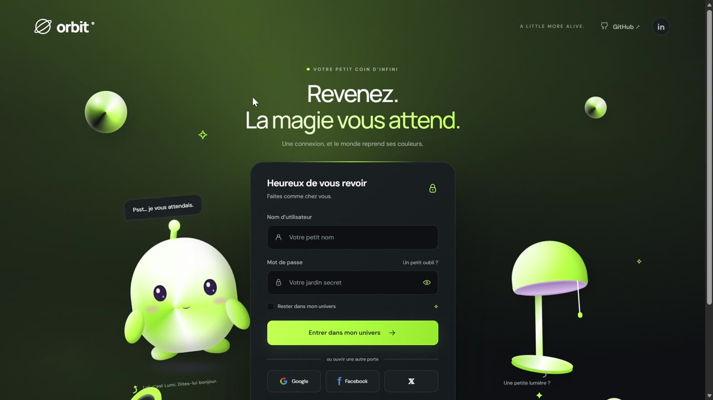

<div align="center">

# Orbit · Lumi
### A login page with a little personality.
An expressive companion. Six color worlds. One HTML file.

[](index.html) [](index.html) [](index.html) [](LICENSE)

[Explore the code](index.html) · [Download ZIP](https://github.com/BAHARI111/orbit-lumi-login/archive/refs/heads/main.zip) · [Meet the creator](https://www.linkedin.com/in/bahari-mohammed-3a97b4407/)


</div>

**Orbit · Lumi** is a playful, reusable frontend login demo built with HTML, CSS and JavaScript. Lumi follows your pointer, covers its eyes when you enter a password, and heads toward an interactive lamp after a successful demo sign-in.

No framework. No build step. Just open `index.html` and explore.

## A small interaction worth remembering

- **Meet Lumi:** a CSS-rendered companion with animated eyes, expressions and pointer reactions.
- **Play with light:** toggle the lamp and watch the scene respond.
- **Choose your mood:** switch between six coordinated color themes.
- **Complete the journey:** fill the form and watch Lumi move behind the card toward the light.
- **Control the motion:** pause animations or use your system's reduced-motion preference.
- **Try the details:** required-field feedback, password visibility, keyboard controls and social-button demo states.

The dimensional look comes from CSS gradients, transforms and animation, without WebGL or external 3D models.

## Start in seconds

```sh
git clone https://github.com/BAHARI111/orbit-lumi-login.git
cd orbit-lumi-login
```

Open **`index.html`** in a recent browser. Alternatively, download and extract the ZIP above. Use a fictional username and password. Try an empty form, switch palettes, click the lamp, and then sign in.

> **Frontend demonstration:** this project does not authenticate users. Google, Facebook and X buttons are illustrative interactions, not OAuth integrations. The page does not send or store credentials, and its session checkbox does not establish a persistent session. Connect your own authentication service for production use.

## Six color worlds

| Theme | Palette |
| --- | --- |
| **Midnight Lime** · default | Black `#0b0e11` · White `#ffffff` · Lime `#c1ff4d` |
| **Navy Coral** | Navy `#101d35` · Cream `#fff4e4` · Coral `#ff8b79` |
| **Forest Electric** | Forest `#102b25` · Sand `#f0e3c7` · Purple `#bd88ff` |
| **Iris** | Iridescent violet, mint and pink |
| **Peach** | Warm peach tones |
| **Sky** | Airy sky tones |

## Make it yours

Everything lives in `index.html`:

| Part | What to customize |
| --- | --- |
| `<style>` | Theme variables, character styling, lighting and animation |
| HTML markup | Labels, branding, profile links and form content |
| `<script>` | Pointer reactions, form feedback and demo sign-in behavior |

Start with `.world[data-theme=...]` to adjust a palette. Replace the demo submit handler to integrate your authentication provider; verify credentials and manage sessions on the server or through that provider.

The interface is in French. Labels can be edited directly in the HTML. DM Sans and Manrope load from Google Fonts; a system sans-serif fallback is used when they are unavailable. Self-host the fonts or remove the import for a fully offline setup.

## Checks

With Node.js installed:

```sh
node tests/smoke.cjs
```

Checks cover JavaScript syntax and form behavior in a simulated DOM: empty fields, focus, password privacy, loading, success, clearing, reset and lamp interaction. They do not replace visual browser or assistive-technology testing.

## Contribute

Ideas, bug reports and pull requests are welcome. Useful contributions include smoother mobile interactions, accessibility improvements, new palettes and translations. See [CONTRIBUTING.md](CONTRIBUTING.md).

If you reuse Orbit · Lumi, I'd love to see what you build. A star also helps other developers discover the project.

## Creator & license

Created by **Bahari Mohammed** · [GitHub](https://github.com/BAHARI111) · [LinkedIn](https://www.linkedin.com/in/bahari-mohammed-3a97b4407/)

**Code:** [MIT](LICENSE). Use and adapt it, including commercially, while retaining the license notice. Third-party fonts, brand marks and the demo soundtrack retain their own rights. The music is not included in the MIT license; see [media credits](media/README.md).
